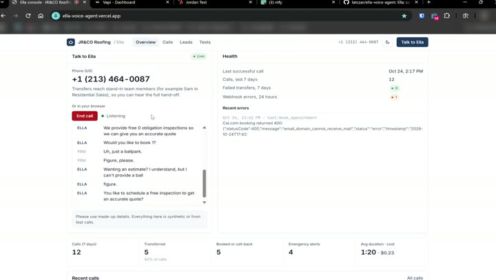
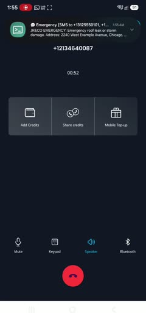
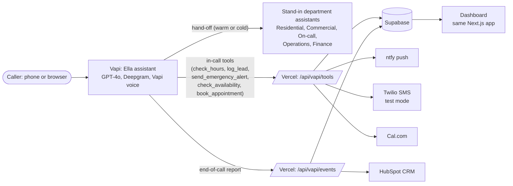

# Ella: AI voice receptionist for JR&CO Roofing

Ella answers every call to JR&CO Roofing (a fictional US roofer), 24/7: she answers questions, captures the caller's details, and transfers, books, alerts on-call or logs a call-back.

## Demo

<table>
  <tr>
    <td align="center" colspan="3">
       
      <b>▶ Browser call</b>: quote and booking, the dashboard, the HubSpot record
    </td>
  </tr>
  <tr>
    <td align="center" width="33%">
       
      <b>▶ Emergency</b>: alert arrives, hand-off to on-call
    </td>
    <td align="center" width="33%">
       
      <b>▶ After hours</b>: inspection booked
    </td>
    <td align="center" width="33%">
       
      <b>▶ Billing</b>: ticket raised for Finance
    </td>
  </tr>
</table>

## Try it

| | |
|---|---|
| Dashboard, and "Talk to Ella" in the browser | https://ella-voice-agent.vercel.app |
| Call Ella (US) | **+1 (213) 464-0087** |

All data is synthetic. Please don't give Ella real personal details.

## How it works

## Stack, and why

| Part | Chose | Why | Instead of (spec suggestion) |
|---|---|---|---|
| Voice | **Vapi** + GPT-4o, Deepgram, Vapi voice | Assistants, tools, hand-offs and numbers all set up from code; one bill | Retell, Bland: no clear gain; ElevenLabs: another account |
| Middleware | **Next.js API routes on Vercel** | Fast, always on, in git, same deploy as the dashboard | n8n: Cloud is a 14-day trial; free self-hosting sleeps and misses mid-call timeouts |
| Knowledge base | **Markdown, inlined into the prompt** | About 840 words; no lookup delay mid-call | Vector DB / RAG: overkill at this size |
| Transfers | **Vapi hand-offs** to stand-in team assistants | Real warm transfers on one free number | Phone system / PBX: needs paid numbers; free numbers can't dial abroad |
| CRM | **HubSpot** (free) | Good API; contact, note, task and ticket per call | AccuLynx, JobNimbus: paid |
| Calendar | **Cal.com** | Free slots and booking API | Not named in spec |
| Alerts | **ntfy push** (+ Twilio SMS behind a switch) | Instant, free, real phone alert | Live Twilio SMS: US texts need paid A2P 10DLC registration |
| Data and dashboard | **Supabase + Next.js** | Free; row-level security keeps real callers private | Not named in spec |

Full reasoning: [architecture](docs/architecture.md#why-each-tool).

One YAML config per client drives the prompts, tools, Vapi assistants and webhooks. [SKILL.md](SKILL.md) rebuilds it for a new client.

## Read more

- [Assumptions and spec gaps](docs/spec-gaps.md)
- [Architecture, tool choices and behaviour](docs/architecture.md)
- [Cost per call, and what was cut](docs/cost-and-scope.md)
- [Setup and tests](docs/setup-and-tests.md)
- [SKILL.md](SKILL.md) (for an agent) and [RUNBOOK.md](RUNBOOK.md) (for a person)
